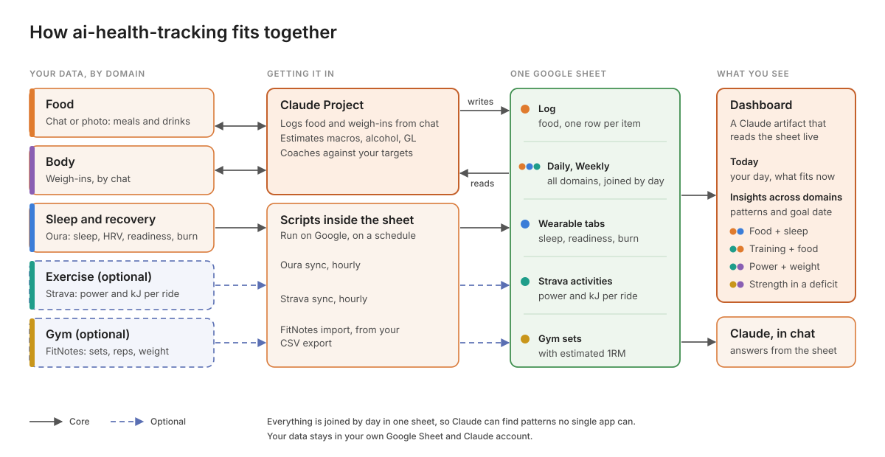

# ai-health-tracking

Log food by chatting with Claude. Your Oura ring syncs into a Google Sheet, and a live dashboard ties what you eat to your training, sleep and weight.

## What you get

- Food logging in plain language or from a photo, with calories, macros, alcohol and glycaemic load estimated for you
- Calorie and carb targets that move with your training
- A live dashboard: your day, longer-term patterns, and whether you're on track for your goal
- Optional ride power (Strava) and gym strength (FitNotes) trends

## What you need

- A Claude plan with Projects, connectors and artifacts (Pro or above)
- A Google account
- An Oura ring with an active membership
- Optional: Strava and FitNotes

## Quick start (30-45 minutes)

1. [Make a copy of the template sheet](https://docs.google.com/spreadsheets/d/1V3z8CsxI_Wnq1YXp4UuXWGJG19kNImMzo2euo6Za9Jk/copy).
2. Download `ai-health-tracking-setup.zip` from the [latest release](../../releases/latest). In Claude, go to **Customize > Skills > + > Create skill > Upload a skill** and upload it.
3. Create a Claude Project (e.g. "Health") and connect **Google Drive / Sheets**.
4. In a new chat in that project, say: **"Set me up using the ai-health-tracking skill."**

Claude then interviews you, sets your targets, connects Oura, writes your project instructions and builds the dashboard.

No skill upload? Add [docs/setup-guide.md](docs/setup-guide.md) and the files in [dashboard/](dashboard) to the project and say "Set me up using the setup guide."

## Docs

[Setup guide](docs/setup-guide.md) · [Data dictionary](docs/data-dictionary.md) · [Sheet formulas](docs/sheet-formulas.md) · [Wearable layer](docs/wearable-layer.md) · [Troubleshooting](docs/troubleshooting.md)

## Privacy

Your data stays in your own Google Sheet and Claude account. You register your own Oura (and Strava) API app and run your own copy of the scripts, and nothing is sent to the author. Tokens are kept in Apps Script user properties. Don't share your sheet publicly.

## Limitations

- Nutrition figures are estimates.
- The dashboard needs Claude's Dashboard artifact type.
- Oura is the only wearable built in so far. No Oura? The sheet and dashboard read three standard `wearable_*` tabs, so you can adapt it to Apple Watch, WHOOP, Fitbit or similar by filling those tabs from your device's data. Claude can help you write the adapter: see the [wearable layer](docs/wearable-layer.md).

## Disclaimer

A personal project shared as is. Not medical, dietetic or training advice. See [DISCLAIMER.md](DISCLAIMER.md).

## Contributing and licence

Issues and pull requests welcome: see [CONTRIBUTING.md](CONTRIBUTING.md). Licensed under [PolyForm Noncommercial 1.0.0](LICENSE): free for personal and non-profit use, commercial use needs permission.
